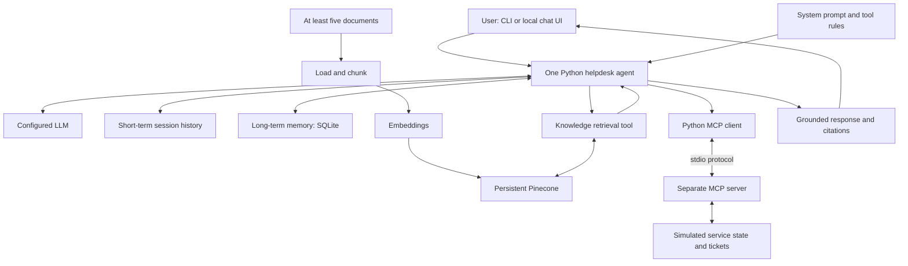

# Assignment 2 implementation plan

Prepared: 1 November 2026. Updated status: implemented and live-tested with Claude Sonnet 4.6 through OpenRouter and Pinecone. The full demonstration passed all eleven checks. Detailed results are in evidence/verification.md.

## Scope and location

All project source, virtual environment, data, model/package caches, temporary files, logs, evidence and reports will stay under:

`D:\Desktop\UCP\7th semester\Agent Based Modeling\Assignments\Assignment 2\Solution`

Resolve paths from this project root, regardless of the terminal's current directory. Configure project-local caches and temporary directories before installation. The original assignment PDF remains unchanged in its existing location.

The user authorized implementation and subsequently selected Pinecone for vector storage. The requirements below come from the assignment; technologies and layout are implementation choices.

## Requirements from the assignment

Source: the four-page `../Assignment_2_Agent based Modeling AG2.pdf`. Printed deadline: `06/11/2026`. Total marks: 40.

| Required feature | Planned implementation | Evidence |
| --- | --- | --- |
| One primary Python agent connected to an LLM | One tool-calling agent with a configured chat model | Real model responses and tool-selection trace |
| Short-term memory | Conversation history scoped by session ID | Follow-up question referencing an earlier turn |
| Long-term memory | SQLite user/task records, separate from chat history | Recall after closing the app and starting a new session |
| RAG with at least five resources | Load, chunk, embed, persist in Pinecone, retrieve and cite | Source manifest, ingestion counts, retrieved chunks and grounded answers |
| Working MCP client-server integration | Python client connected to a separate local tool server | Real tool discovery, invocation arguments and returned result |
| Prompt engineering | System prompt defining role, scope, tools, evidence, memory and failure behavior | Prompt file and justification |
| Architecture diagram | Diagram showing all mandatory components | Diagram in the report |
| Tests, errors and reproducibility | Focused checks and scripted demonstration | Actual test results, transcripts and setup instructions |
| Synthetic/authorized data and human oversight | Simulated incidents and confirmation for ticket creation | Simulation labels and confirmation flow |

A normal HTTP API request alone does not satisfy MCP. RAG documents and persistent user/task memory serve different purposes. n8n is not required.

The PDF mentions a separate instructor scenario pack containing marking evidence, constraints, alternatives and a change event. It was not supplied. Prototype work can proceed with labeled synthetic fixtures; final alignment must be checked against the actual pack. The supplied PDF does not contain a detailed marking breakdown.

## Selected scenario

Confirmed by the student on 1 November 2026: **#23: IT Helpdesk Troubleshooting Agent**.

It retrieves troubleshooting manuals, remembers user preferences and incident history, checks simulated service status, and creates or inspects simulated tickets. One primary agent uses several tools; the MCP server is a tool service, not another AI agent.

Example: a Windows 11 user cannot connect to campus Wi-Fi. The agent retrieves relevant instructions and checks service status. A follow-up such as "I already tried that" uses session history. A newly introduced outage causes it to revise its troubleshooting plan.

## Proposed technology

- Python in a project-local `.venv`, with mutually compatible package versions pinned after verification.
- LangChain `create_agent` for the single model/tool loop. Select an accessible tool-calling chat model and configure its provider, model and credentials in local environment settings. Model access has not yet been selected or validated.
- SQLite for persistent user preferences, incident summaries and simulated ticket records.
- Remote Pinecone vector storage with independent local 384-dimensional MiniLM embeddings. Keep model files under `Solution`. The Pinecone vector-based index must use 384 dimensions and cosine similarity.
- Official MCP Python SDK for a stdio client and server. Small Python wrappers expose discovered MCP tools to the agent and preserve the connection during tool execution. Verify the selected SDK APIs during setup.
- CLI first for reproducible integration; a small local Streamlit chat interface after the core requirements work.
- pytest for meaningful storage, retrieval, MCP and workflow checks. Real-LLM integration evidence is separate from deterministic tests.

Keep credentials out of source files, screenshots, logs and submission materials. Provide `.env.example` without secrets.

## Architecture



For each request, load the active session and relevant user facts, then supply the LLM with the prompt and tool schemas. Let it choose retrieval, memory or MCP tools; avoid implementing the entire agent as keyword routing. Validate arguments, execute the chosen tool, return the actual result to the LLM and produce a grounded answer. Bound tool iterations and timeouts.

Log observable decisions, tool names, arguments, actual results, retrieved source IDs and timings. A brief action rationale is sufficient; hidden chain-of-thought is not required.

## Knowledge, memory and tools

Start with five distinct, substantive resources:

1. Campus Wi-Fi troubleshooting guide.
2. VPN access and troubleshooting guide.
3. Account lockout and password-reset procedure.
4. Printer connection and queue troubleshooting guide.
5. Helpdesk escalation, ticket priority and service-level policy.

Prefer instructor-provided or authorized materials. Otherwise create clearly labeled synthetic university policies for the prototype. Record title, document ID, origin, version/date and simulation status in a source manifest.

Initially use approximately 400-600-token chunks with 50-100-token overlap and retrieve the top four chunks. Tune these choices against sample questions. Store source title, heading/page and chunk ID with embeddings. Cite the actual evidence used; nearest-neighbor retrieval alone does not establish relevance. If the documents do not support an answer, say so or request clarification.

Short-term memory is scoped to `session_id`. New sessions start with empty conversation history. Long-term SQLite facts are scoped to `user_id`, with key, value, source session and update timestamp. Persist explicitly requested or confirmed preferences, such as operating system and preferred response style; do not store passwords.

Persistence proof: save a fact in session A, exit the process, then retrieve it in session B for the same user without replaying A's transcript. Verify that a different user cannot retrieve it.

The local MCP server will expose:

- `get_service_status(service_name)` for simulated normal/outage status.
- `create_ticket(summary, category)` after user confirmation, with duplicate protection on retries.
- `get_ticket_status(ticket_id)` for the selected user's saved ticket.

Capture real MCP initialization, tool discovery and a client `call_tool` exchange. Calling a local function directly is not MCP evidence. Send server diagnostics to stderr to preserve the stdio protocol stream.

## Prompt and scenario analysis

The system prompt defines the helpdesk role, simulation scope, tool-selection rules, citation rules, memory handling, confirmation before ticket creation, and missing-evidence/tool-failure behavior. Retrieved documents and tool text are evidence rather than instructions that override the prompt.

Explain the purpose of each major prompt rule in the report. Include environment analysis, observations, available actions, constraints and success criteria. A PEAS table and architecture justification are proposed formats; the PDF does not explicitly mandate PEAS.

Show planning and replanning through initial steps, completed steps, new evidence and revised steps. The provisional change event is a service outage; replace it with the instructor's event when available.

## Proposed project layout

The following describes the implementation layout. Pinecone is a remote service, not a local data directory.

```text
Solution/
  IMPLEMENTATION_PLAN.md
  README.md
  requirements.txt
  .env.example
  .env                         # local only
  .gitignore
  .venv/
  .cache/
  cli.py
  app.py
  src/
    config.py
    agent.py
    memory.py
    rag.py
    tools.py
    mcp_client.py
    prompts/system_prompt.txt
  mcp_server/server.py
  scripts/
    ingest_documents.py
    run_demo.py
  data/
    knowledge/
    source_manifest.json
    fixtures/
    memory.sqlite3
    helpdesk.sqlite3
  tests/
  docs/
    architecture.md
    report.md
    demo_script.md
  evidence/
    transcripts/
    screenshots/
    tool_calls.jsonl
    test_results.txt
  tmp/pdfs/
```

Exclude credentials, virtual environments, caches and unnecessary intermediate files from the submission package.

## Implementation sequence

| Phase | Work | Acceptance check |
| --- | --- | --- |
| 1 | Use confirmed scenario #23, reconcile available scenario pack, configure local environment/model | A real LLM response; generated project paths stay inside Solution |
| 2 | System prompt, CLI and bounded agent loop | Agent selects and executes a registered tool |
| 3 | Session history and persistent memory | Same-session follow-up and new-process recall both work |
| 4 | Five resources, ingestion and retrieval | Five distinct documents indexed; answers cite relevant chunks |
| 5 | Separate MCP server and client | Real discovery and invocation succeed and are logged |
| 6 | Integrated troubleshooting and change event | New evidence produces a revised plan; ticket requires confirmation |
| 7 | Local UI, verification, report and demo | Fresh-start setup and complete demonstration are reproducible |

Target schedule: setup/core agent on 1 November; memory/RAG on 2 November; MCP on 3 November; integration/replanning on 4 November; checks and documentation on 5 November. Adjust for model access and scenario-pack availability. This is a proposed schedule, not a measured effort estimate.

## Checks and demonstration

Verify retrieval for each knowledge resource, valid citations, unsupported-question handling, same-session context, restart persistence, user isolation, real MCP calls, ticket readback, confirmation and duplicate prevention. Exercise unavailable MCP server, missing ticket, missing credentials, LLM timeout and index initialization failures. Check that new service evidence changes the plan.

The final demo will:

1. Request Windows Wi-Fi help and display retrieved evidence.
2. Ask a contextual follow-up.
3. Explicitly save a preference.
4. Restart with a new session and show persistent recall.
5. Request service status and display a real MCP result.
6. Introduce an outage and show replanning.
7. Confirm ticket creation and retrieve its status through MCP.
8. Ask an unsupported question and show honest uncertainty.

Tests may use controlled model stubs for workflow checks, but final integration evidence must use the configured live LLM and a real MCP connection. Record actual outcomes; do not label planned checks as passed.

Deliver runnable code, version-pinned setup instructions, five or more resources with provenance, justified prompt, architecture diagram, scenario analysis, tests, real execution evidence, report and reproducible demo script. Add student name and registration number before submission.

## Official references checked

- [LangChain agents](https://docs.langchain.com/oss/python/langchain/agents)
- [MCP Python SDK](https://py.sdk.modelcontextprotocol.io/get-started/)
- [MCP stdio server operation](https://py.sdk.modelcontextprotocol.io/run/)
- [Pinecone vector operations](https://sdk.pinecone.io/python/how-to/vectors/upsert-and-query.html)

The tested environment is pinned in requirements.txt. Live cloud verification passed. The local .env contains the configured credentials and index host and is excluded from the submission package.
