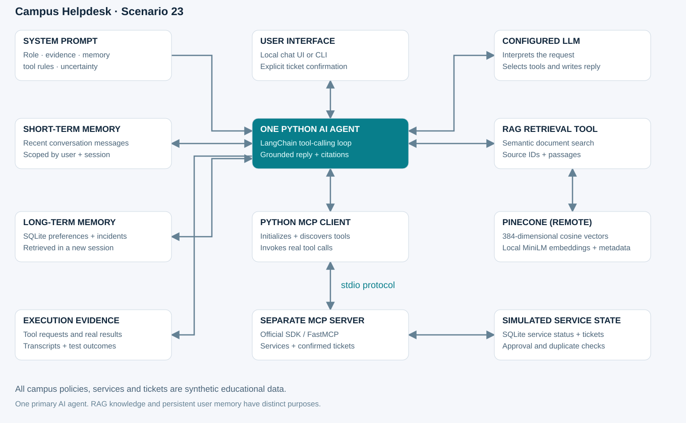
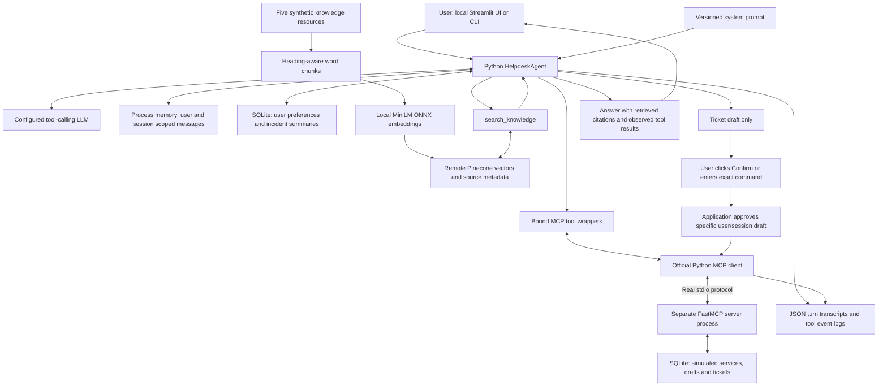

# Architecture: Campus Helpdesk

Scenario 23. One primary agent, one configured chat model, multiple ordinary tools and one separate MCP tool service.

The SVG is a standalone diagram. The Mermaid source below preserves the same component relationships in editable form.

## Responsibilities

- `src/config.py` resolves project-local paths and configures the model from `.env` without exposing the key.
- `src/agent.py` supplies context and tools to LangChain `create_agent`; the LLM selects tools and produces the final answer. This is not a prewritten decision tree.
- `src/storage.py` opens SQLite connections per operation, namespaces user records, enforces draft confirmation and deduplicates repeated ticket creation.
- `src/rag.py` chunks five resources, generates local neural embeddings, persists vectors and retrieves relevant passages with citation IDs.
- `src/mcp_client.py` initializes a real MCP session, discovers tools and invokes them through stdio.
- `mcp_server/server.py` executes service/ticket operations in another Python process.
- `src/prompts/system_prompt.txt` defines role, scope, tool use, memory, evidence, replanning and failure behavior.

## What survives a restart

| Store | Content | Lifetime |
| --- | --- | --- |
| Agent session dictionary | Recent user, assistant and tool messages | Current Python process; isolated by user/session |
| SQLite memory/incidents tables | Explicitly authorized preferences and summaries | Persists across sessions and processes |
| Pinecone namespace | Document vectors, text and provenance | Remote persistent store; connection details pending |
| SQLite service/draft/ticket tables | Synthetic operational state and confirmed requests | Persists across processes |
| Evidence directory | Observable tool activity and response transcripts | Local assessment record |

RAG knowledge and user memory have distinct roles. SQLite holds user memory and simulated operations; Pinecone holds document knowledge. Working files stay in Solution; vectors are uploaded remotely after configuration. No hidden reasoning traces are required or stored.

## Failure and action boundaries

The model sees draft creation, not a tool that can approve a draft. Only a trusted UI/CLI confirmation path sets approval. The server rechecks draft owner, session and approval before creating a ticket. A unique draft-to-ticket relationship prevents duplicates.

MCP connection failure leaves knowledge/memory tools available, while status tools report that current state is unknown. Missing credentials, empty index, unknown ticket and LLM failure produce explicit errors. Session history is limited to ten complete user turns to preserve tool-call pairing. This is a bounded-context prototype, not unlimited conversation recall.

User IDs are local demo identities rather than authenticated accounts. This design must not be exposed publicly without authentication, authorization and data retention work.
